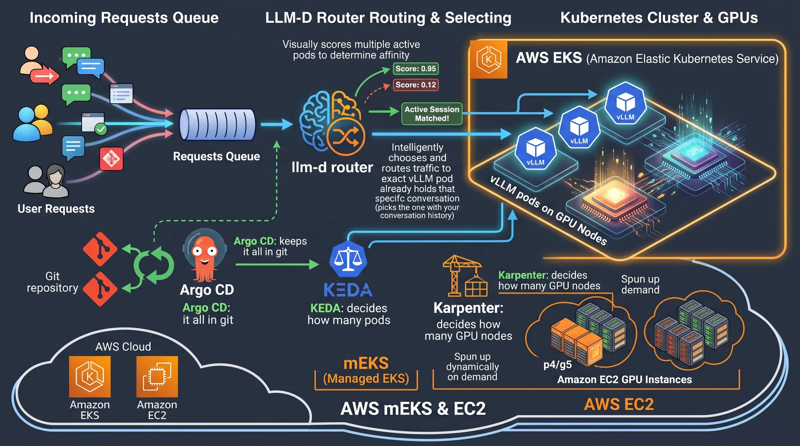

# llm-d on EKS — autoscaled LLM inference you can afford to practice on

[](https://didibe.dev/blog/llm-d-serving-llms-on-kubernetes)

**Read the article:** [llm-d in Plain English: Serving LLMs on Kubernetes](https://didibe.dev/blog/llm-d-serving-llms-on-kubernetes) - the plain-English story behind this repo.

A learning lab: [llm-d](https://llm-d.ai) **v1.0.0** serving open-weights models
on EKS, autoscaled on **inference queue depth** (not CPU), with GPU nodes that
appear when needed and disappear when idle. **Terraform + GitHub Actions** build
the infrastructure; **Argo CD** runs everything on the cluster from git. A
`git push` is the only deploy button.

It is not "production grade." It is a practice environment where a real 72B
model costs about **$8.70/hour** while you use it and **nothing** once you
switch it off — one line in git takes the GPUs away, one workflow takes
everything else.

```
 git push ─┬─▶ GitHub Actions (OIDC) ─▶ Terraform ─▶ VPC, EKS, IAM, Karpenter,
           │                                         KEDA, Prometheus, Argo CD
           │
           └─▶ Argo CD (pulls from git) ───────────▶ llm-d router + endpoint picker
                                                     vLLM model server (KEDA-scaled)
                                                     Karpenter NodePool (GPU nodes on demand)
                                                     Open WebUI · NVIDIA device plugin
```

> **New to LLM serving or Kubernetes?** Start with
> [Serving LLMs on Kubernetes, in plain English](#serving-llms-on-kubernetes-in-plain-english). Already know the
> pieces? Jump to [Quick start](#quick-start).

---

## Contents

- [Quick start](#quick-start)
- [Tiers](#tiers)
- [How deploys work](#how-deploys-work)
- [Why Argo CD](#why-argo-cd)
- [Using the model](#using-the-model)
- [Costs](#costs)
- [Guardrails](#guardrails)
- [Serving LLMs on Kubernetes, in plain English](#serving-llms-on-kubernetes-in-plain-english)
- [Architecture](#architecture)
- [Setting it up in your own account](#setting-it-up-in-your-own-account)
- [Layout](#layout)
- [Commands](#commands)
- [Lessons learned](#lessons-learned)
- [Honest caveats](#honest-caveats)

---

## Quick start

Everything is driven by one file, [`deploy/config.yaml`](deploy/config.yaml):

```yaml
cluster: false   # may CI create the EKS cluster?
tier: none       # none | sim | small | gpu | kimi — what Argo CD runs on it
```

Change it, push it, and CI + Argo CD converge on it. The Makefile wraps the
edit-commit-push:

```bash
make cluster-on            # cluster: true  -> CI builds EKS + Argo CD (~20 min, ~$0.26/hr)
make tier TIER=kimi        # tier: kimi     -> Argo CD deploys Kimi-Dev-72B
make follow                # watch CI wait for Argo CD and smoke-test the model
make kubeconfig            # kubectl access; `make argocd-ui` for the Argo CD UI

make tier TIER=none        # GPUs gone, cluster stays (~$0.26/hr)
make cluster-off && make destroy   # everything billable gone (~$0)
```

> **Nothing switches it off for you.** A tier keeps its GPU node(s) running
> until you set `tier: none` or run `make destroy` — Kimi left on is ~$200/day.
> See [Guardrails](#guardrails).

**Try it for free first.** `make argocd-local` builds the same stack on a local
kind cluster — the same Argo CD install and root app, syncing this repo from
GitHub — against a vLLM simulator. **$0.00.**

---

## Tiers

Every tier is the same Helm chart (`gitops/apps/model-server`) with a different
values file in [`gitops/tiers/`](gitops/tiers). Which one runs is the `tier` key
in [`deploy/config.yaml`](deploy/config.yaml).

| Tier | Model | Hardware | Capacity | Replicas | ~$/hr while up* |
|------|-------|----------|----------|----------|------------------|
| `sim` | [`llm-d-inference-sim`](https://github.com/llm-d/llm-d-inference-sim) (fake vLLM) | `c7i.large` | spot | 1–4 | 0.29 |
| `small` | `Qwen/Qwen3.5-4B` | `g6.xlarge` — 1× L4, 22 GB | spot | 1–2 | 0.79–1.32 |
| `gpu` | `Qwen/Qwen3.6-27B-FP8` | `g6e.xlarge` — 1× L40S, 44 GB | spot | 1–2 | 2.06–3.86 |
| **`kimi`** ⭐ | **`moonshotai/Kimi-Dev-72B`** | **`g7e.12xlarge` — 2× RTX PRO 6000, 192 GB** | **on-demand** | **1** | **8.68** |
| `none` | — | — | — | 0 | 0.26 (cluster only) |

\* Including the ~$0.26/hr the cluster costs whenever it exists. Spot prices move;
re-measure with `make prices`.

**Why these shapes:** the account's GPU quota in `us-west-2` is **64 vCPU
on-demand** and **8 vCPU spot** (G and VT family). Spot fits two 4-vCPU
single-GPU nodes, which is what `small` and `gpu` use to demo scale-out 1→2.
`kimi` needs a 48-vCPU node; that only fits the on-demand quota, and only once —
so it is a fixed single replica.

**About Kimi-Dev-72B:** a 72.7B coding model (Qwen2.5-72B base, MIT licence,
ungated). It ships BF16 only — 145 GB of weights, ~135 GiB in VRAM — so it runs
**tensor-parallel across two 96 GB GPUs**, leaving ~34 GiB for KV cache
(~110k tokens: three full 32k-context conversations, or many short ones). It
reasons in a `◁think▷` block before answering, so give it a generous
`max_tokens`. The larger Kimi K2/K3 models (1T+ parameters) do not fit any
single AWS G-family instance.

Measured on the first deploy:

| | |
|---|---|
| GPU node launch → Ready | ~2 min |
| Weights download (145 GB, gp3 at 1000 MB/s) | ~6 min (~370 MB/s) |
| Load + CUDA graph capture | ~4 min |
| **Cold start total** | **~12–15 min** |
| Single-request decode speed | ~18 tokens/s |

---

## How deploys work

Two reconcilers, each owning what it is good at:

```
push to main
   │
   ├─ terraform/10-cluster/** or deploy/config.yaml changed
   │     └─ CI: terraform plan → apply only if non-empty        (never while cluster: false)
   │        EKS, VPC, IAM, Karpenter, KEDA, Prometheus, Argo CD + the root Application
   │
   └─ gitops/** or deploy/** changed
         └─ Argo CD notices the commit and syncs the cluster to it
            CI (verify job) requests a refresh, waits until every app is
            Synced + Healthy, then smoke-tests a completion through the router
```

- **No pointless applies.** Terraform runs only for infra changes and applies
  only non-empty plans. Docs and README pushes trigger nothing.
- **No accidental spend.** While `cluster: false`, CI creates nothing — no push
  can start the $0.26/hr base cost by mistake.
- **Drift is impossible to keep.** Argo CD self-heals: a `kubectl edit` on the
  cluster is reverted to what git says.
- **One at a time.** Deploy and destroy share a concurrency group.
- **Credentials.** GitHub Actions assumes IAM roles via OIDC (no stored AWS
  keys). Argo CD pulls the public repo and needs no credentials at all.

`make cluster-apply-local` is the only local apply and requires
`ALLOW_LOCAL=1` (break-glass). `00-bootstrap` is applied by hand because it
creates the role CI uses.

---

## Why Argo CD

The first version applied the inference layer with Terraform from CI. It worked,
but most of its failures came from Terraform waiting on Kubernetes: a 10-minute
rollout deadline while a 145 GB model was still loading, an orphaned Deployment
blocking a re-apply, a 50-minute rollout wait holding the state lock. Splitting
the responsibilities fixes that class of problem:

| | Terraform + GitHub Actions | Argo CD |
|---|---|---|
| Owns | VPC, EKS, IAM, access entries, Karpenter controller, KEDA, Prometheus, Argo CD itself | llm-d router, model server, NodePool + EC2NodeClass, ScaledObject, public Services, Open WebUI, NVIDIA plugin |
| Changes | rarely | constantly |
| How | push → plan → apply | push → Argo CD syncs (asynchronously) |
| Why | needs AWS identities and values that must not be in git | pure Kubernetes; benefits from self-heal, pruning and a UI |

How the hard parts were solved:

- **Secrets and private values never enter git.** Terraform writes them where
  Argo CD can use them: the HuggingFace token as a Kubernetes Secret, and the
  IP allowlist plus the Karpenter node IAM role as `valuesObject` on the root
  Application it creates. The repo is public; none of these are in it.
- **Switching off goes through git too.** Deleting resources by hand would
  just be undone by Argo CD, so `tier: none` is committed and Argo CD prunes
  the inference layer; deleting the NodePool makes Karpenter return the nodes.
- **Teardown cascades.** Every Application carries Argo CD's resources
  finalizer, so deleting the root app removes the NodePools (Karpenter
  terminates the nodes) and the Services (EKS deletes the NLBs) before
  Terraform removes the cluster.
- **Argo CD doesn't fight the autoscaler.** The model Deployment sets no
  `replicas` and its Application ignores `/spec/replicas`; KEDA's HPA owns it.
- **Synchronous feedback kept.** CI's verify job waits for Argo CD to report
  every app Synced + Healthy and smoke-tests the model, so a push still ends in
  a green or red check.

---

## Using the model

**Open WebUI** — a ChatGPT-style interface on its own load balancer. Its URL is
in the deploy run's summary, or:

```bash
kubectl -n llm-d get svc open-webui-public
```

No login: it is reachable only from the IPs in `ALLOWED_CIDRS`. Chats are not
persisted (no volume), so a pod restart or `tier: none` wipes them.

**OpenAI-compatible API** — the router's public endpoint, same IP allowlist:

```bash
EP=$(kubectl -n llm-d get svc llm-d-public -o jsonpath='{.status.loadBalancer.ingress[0].hostname}')
curl -s http://$EP/v1/chat/completions -H 'Content-Type: application/json' -d '{
  "model": "moonshotai/Kimi-Dev-72B",
  "messages": [{"role": "user", "content": "Write a palindrome checker in Python."}],
  "max_tokens": 800
}' | jq -r '.choices[0].message.content'
```

Tool calling (`tool_choice: "auto"`) is enabled on the Kimi tier with vLLM's
`hermes` parser — Open WebUI and most agent frameworks need it.

**Argo CD UI** — sync state and health of every resource:

```bash
make argocd-ui        # prints the admin password, serves http://localhost:8090
make apps             # same, in the terminal
```

**On the free kind stack** the router is at `http://localhost:18080` and Open
WebUI at `http://localhost:18081`.

**Logs:**

```bash
kubectl -n llm-d logs -f deploy/llm-d-vllm-decode     # vLLM: download, load, requests
kubectl -n llm-d logs -f deploy/llm-d-epp -c epp      # router: which backend got each request
kubectl -n kube-system logs -f deploy/karpenter       # node launches and terminations
make watch                                            # pods, HPA, nodes at a glance
```

---

## Costs

Measured in `us-west-2`, November 2026.

**Whenever the cluster exists — ~$0.26/hr (~$6.20/day):**

| Item | $/hr |
|------|------|
| EKS control plane | 0.100 |
| 2× `t3.xlarge` spot system nodes | ~0.102 |
| Public IPv4 addresses (~6 × $0.005) | ~0.030 |
| Network Load Balancers (router + WebUI) | ~0.045 |
| System node EBS | ~0.004 |

**Added while `kimi` runs — ~$8.42/hr:** `g7e.12xlarge` on-demand $8.29, plus
the 400 GB high-throughput gp3 root volume (~$0.13). The same instance is ~$5.46
on spot, but this account's 8-vCPU spot quota cannot hold a 48-vCPU node.

| Scenario | Cost |
|----------|------|
| 2-hour Kimi session | ~$17.50 |
| Cluster idling, no GPU | ~$6.20/day |
| `make destroy` | ~$0 (S3 state only) |

**Where money leaks, and what this repo does about it:**

| Leak | Naive cost | Here |
|------|-----------|------|
| NAT Gateway (3 AZ) | $0.135/hr + $0.045/GB | **none** — public subnets + IGW; a 145 GB model download costs $0 in transfer |
| Forgotten GPU node | $200/day (Kimi) | `make tier TIER=none` + budget alert — nothing turns it off automatically |
| EKS control plane left up | $73/month | `make destroy` (CI) |

`make cost` shows actual spend attributed by the `Project` tag. Older model/shape
analysis from the 8-vCPU-spot era lives in [`docs/COSTS.md`](docs/COSTS.md).

---

## Guardrails

> [!WARNING]
> There is **no scheduled shutdown**. Every tier keeps at least one model
> replica (`minReplicas: 1`), so its GPU node runs until you turn it off. End
> every session with `make tier TIER=none` (or `make destroy`).

- **`tier: none`** (`make tier TIER=none`) — Argo CD prunes the inference
  layer; deleting the NodePool makes Karpenter terminate its nodes. The
  cluster stays (~$0.26/hr). CI's verify job fails if any NodePool remains.
- **Karpenter consolidation** — a GPU node is terminated about a minute after
  its last model pod leaves.
- **NodePool vCPU limits** match the quota, so an over-ask shows up as a
  Pending pod rather than a stream of EC2 errors.
- **Destroy on demand** (`.github/workflows/destroy.yml`, `make destroy`) —
  deletes the root Argo CD app (cascading to NodePools and NLBs), waits for the
  NLBs and GPU nodes to go, destroys the cluster, sweeps leaked network
  interfaces and orphaned instances, and fails if anything billable remains.
  Leaves only the S3 state bucket and the OIDC deploy role. Run `make cluster-off` first
  so the next push can't rebuild it.
- **`cluster: false` gate** — CI never creates the cluster unless git says so.
- **AWS Budget + email** — set the `BUDGET_ALERT_EMAIL` secret to enable. It
  tells you after the money is spent; it does not stop anything.
- **`make whats-running`** — lists anything billable still up in the region.
- **IP allowlist** on both public endpoints (`ALLOWED_CIDRS`); the chart refuses
  to render internet-facing Services on EKS if the list is empty.
- **Tagging** — every resource carries `Project=llm-d-eks-lab`.

---

## Serving LLMs on Kubernetes, in plain English

*Also published as [an article](https://didibe.dev/blog/llm-d-serving-llms-on-kubernetes).*

### Why an LLM is not a web app

Three things break the usual Kubernetes playbook:

1. **The model has to fit in GPU memory.** Weights live in VRAM, not RAM. Rule of thumb: about 1 byte per parameter at FP8, 2 at BF16. A 72B model in BF16 is roughly 145 GB. No single GPU holds that, so it gets split across two.
2. **GPU utilization lies.** A GPU doing inference reads about 100% busy whether it is keeping up or hopelessly behind. CPU-style autoscaling cannot tell the difference.
3. **Requests have memory.** While generating, the model keeps notes on the conversation in VRAM. That is the **KV cache**. Send the next message to a different pod and the notes are gone - it has to re-read the whole conversation.

Everything below is a consequence of those three.

### Who decides what

Think of a busy restaurant. Customers queue at the door. A **maitre d'** decides which table each one gets. A **manager** decides how many waiters are on shift. A **staffing agency** decides how many kitchens to rent.

| Piece | In the restaurant | What it decides |
|---|---|---|
| **llm-d router** (EPP) | maitre d' | which pod gets this request |
| **KEDA** | manager | how many pods |
| **Karpenter** | staffing agency | how many GPU nodes |
| **vLLM** | the kitchen | actually runs the model |

Three of those sound alike. They are not. Mixing them up is the most common confusion.

### What llm-d adds

A plain Kubernetes Service round-robins. For LLMs that wastes exactly what you paid for.

llm-d puts a router in front: Envoy plus an **endpoint picker (EPP)**. For every request it scores every pod:

- **queue length** - how busy is it right now
- **KV-cache use** - how full is its memory
- **prefix-cache hit** - does it already hold this conversation's notes

The same conversation lands on the pod that already has it. No re-reading. Faster first token, less wasted GPU.

### Scale on queue depth, not GPU %

The router sees every request, so it knows how many are waiting. That is the real demand signal. KEDA reads it from Prometheus:

```yaml
triggers:
  - type: prometheus
    metricType: AverageValue
    metadata:
      query: sum(llm_d_epp_flow_control_queue_size{model_name="..."})
      threshold: "1"   # one waiting request per replica = add a pod
```

Nothing waiting: you are keeping up. Something waiting: add capacity. The whole loop:

1. Requests pile up. KEDA adds a pod.
2. No free GPU, so the pod sits **Pending**.
3. Karpenter sees it, reads what it asked for, and launches a matching GPU node.
4. Traffic stops. Replicas drop. The node is empty.
5. About a minute later, Karpenter gives it back.

Idle GPU cost is zero. That is the whole point.

### The VRAM math

```
 +------------------ 2 x 96 GB GPU -------------------+
 |  weights ~135 GiB (split)      |  KV cache ~34 GiB  |
 +--------------------------------+--------------------+
        fixed cost                  how many people fit
```

Weights are a fixed cost. What is left over is KV cache, and KV cache is how many conversations fit at once. Squeeze it and requests queue - which is why queue depth is the right signal. For Kimi-Dev-72B on two 96 GB GPUs that is about 110,000 tokens of cache: roughly three full 32k conversations at the same time.

### The whole thing in four lines

- An LLM needs its weights in VRAM, a KV cache per conversation, and a GPU that reads 100% busy either way.
- llm-d puts a router in front that picks the pod by queue, cache use and prefix hits.
- KEDA scales pods on queue depth. Karpenter buys GPU nodes for pending pods and returns them when empty.
- Keep it all in git and it costs about $8 an hour while you use it, nothing after.

The mental model that stuck: **llm-d is a load balancer that knows what is in each GPU's memory.** The sharp edges I hit along the way are in [Lessons learned](#lessons-learned).

### Jargon decoder

| Term | Meaning |
|------|---------|
| **VRAM** | Memory on the GPU. Decides which models fit. |
| **FP8 / BF16** | 1 vs 2 bytes per weight. FP8 halves memory for a small quality cost. |
| **TP / tensor parallelism** | Splitting one model across several GPUs. Kimi uses TP=2. |
| **quota** | AWS's cap on what you may launch, counted in **vCPUs**. Starts at zero for GPUs. |
| **spot / on-demand** | Spot is discounted spare capacity AWS can reclaim with 2 minutes' notice; on-demand is full price and stable. |
| **OIDC** | Lets GitHub Actions prove its identity to AWS and get short-lived credentials — no stored keys. |
| **NLB** | Network Load Balancer — the public entry point for a Service. |
| **IGW / NAT** | Ways out to the internet; the IGW is free, a NAT Gateway is not. |

---

## Architecture

```
                         Internet (ALLOWED_CIDRS only)
                     │                              │
              NLB :80 (API)                  NLB :80 (Open WebUI)
                     │                              │
        ┌────────────▼─────────────┐   ┌────────────▼──────────┐
        │ llm-d router v1.0.0      │◀──│ Open WebUI            │
        │ Envoy + Endpoint Picker  │   │ (system nodes)        │
        └────────────┬─────────────┘   └───────────────────────┘
                     │  picks a backend: queue, KV-cache and prefix aware
        ┌────────────▼─────────────┐
        │ vLLM 0.30 model server   │◀── KEDA: replicas from EPP queue depth
        │ (or llm-d-inference-sim) │      (Prometheus → ScaledObject → HPA)
        └────────────┬─────────────┘
                     │
        ┌────────────▼─────────────┐
        │ Karpenter NodePool       │◀── launches GPU nodes for Pending pods,
        │ per tier, GPU-tainted    │    terminates them when empty
        └──────────────────────────┘
```

- **Standalone router mode.** The llm-d router runs its own Envoy sidecar and
  is exposed by a plain LoadBalancer Service, so no Gateway API dataplane is
  needed. Istio is installed only if `enable_istio = true` (off by default).
- **No AWS Load Balancer Controller.** Services use the
  `aws-load-balancer-type: nlb` annotation, which the controller built into EKS
  handles.
- **No NAT Gateway.** Nodes sit in public subnets behind security groups;
  model downloads go straight out the IGW.
- **NVIDIA device plugin** is an Argo CD app on the GPU tiers: the EKS AL2023
  NVIDIA AMI ships the driver but not the plugin.
- **App of apps.** Terraform creates one Argo CD Application, `root`, pointing
  at `gitops/root`. It reads `tier` from `deploy/config.yaml` and renders one
  child Application per component; `tier: none` renders none, so Argo CD prunes
  them all.
- **Access.** Cluster admins are explicit EKS access entries — the human admin
  and the CI deploy role — rather than "whoever ran Terraform."

### Pinned versions

| Component | Version |
|-----------|---------|
| EKS | 1.37 |
| llm-d router chart (`llm-d-router-standalone`) + EPP | v1.0.0 |
| vLLM image | `vllm/vllm-openai:v0.30.0` |
| `llm-d-inference-sim` | v1.0.0 |
| Gateway API / Inference Extension CRDs | v1.6.2 / v1.6.2 |
| Karpenter | 1.15.1 |
| KEDA | 2.21.0 |
| kube-prometheus-stack | 92.16.0 |
| NVIDIA device plugin | 0.20.1 |
| Open WebUI chart | 18.3.0 |
| Argo CD chart | 10.18.0 (Argo CD v3.6.1) |

The `validate` workflow checks that pinned charts and CRD URLs still resolve,
and renders every GitOps chart for every tier and environment through strict
schema validation (Kubernetes + Karpenter/KEDA/Argo CD CRDs).

---

## Setting it up in your own account

You need Terraform ≥ 1.13, the AWS CLI v2, `kubectl`, `helm` and the `gh` CLI.
`kind` + Docker for the free local tier; `k6` for `make load` (falls back to a
container).

**1. GPU quota.** In your chosen region (default `us-west-2`), request
*Running On-Demand G and VT instances* (`L-DB2E81BA`) and/or *All G and VT Spot
Instance Requests* (`L-3819A6DF`). Both are counted in **vCPUs** and start at
zero. `kimi` needs 48 on-demand; `small`/`gpu` need 4 spot per replica. Check
with `make quota`.

**2. Bootstrap — the only layer applied from your machine**, because it creates
the role CI uses. Create `terraform/00-bootstrap/terraform.tfvars`:

```hcl
github_repo = "<owner>/<repo>"
# If the account already has the GitHub OIDC provider from another project:
# create_github_oidc_provider = false
# If the repo uses immutable OIDC subjects, set the prefix from
#   gh api repos/<owner>/<repo>/actions/oidc/customization/sub
# github_oidc_sub_prefix = "repo:<owner>@<id>/<repo>@<id>"
```

On a brand-new account the state bucket does not exist yet: comment out the
`backend "s3"` block in `terraform/00-bootstrap/versions.tf`, run
`make bootstrap`, restore the block, then run `terraform init -migrate-state`
in that directory. After that, `make bootstrap` works directly.

**3. Repo settings** (values from the bootstrap outputs):

| Kind | Name | Value |
|------|------|-------|
| secret | `AWS_DEPLOY_ROLE_ARN` | `github_deploy_role_arn` |
| secret | `ALLOWED_CIDRS` | e.g. `["203.0.113.7/32"]` — who may reach the endpoints |
| secret | `HF_TOKEN` | optional; faster HuggingFace downloads |
| secret | `BUDGET_ALERT_EMAIL` | optional; enables the budget alert |
| variable | `STATE_BUCKET` | `state_bucket` |
| variable | `ADMIN_PRINCIPAL_ARN` | your IAM user/role ARN, for `kubectl` |

`ALLOWED_CIDRS` is a secret rather than a variable so your IP is masked in
Actions logs, which are public on a public repo.

**4. Deploy.** `make cluster-on` (CI builds EKS and Argo CD, ~20 min), then
`make tier TIER=sim` to prove the path for pennies, then the tier you want.
If you fork the repo, set `gitops_repo_url` in `terraform/10-cluster/variables.tf`
and `repoURL` in `gitops/root/values.yaml` to your fork — Argo CD must read the
repo without credentials, so it has to be public.

**5. Protect `main`.** The deploy role has AdministratorAccess and trusts only
workflows running on `main`, so whoever can push to `main` controls the AWS
account. Block force-pushes and require reviews from anyone but you.

---

## Layout

```
deploy/config.yaml        the switch: cluster true|false, tier none|sim|small|gpu|kimi
terraform/
  00-bootstrap/           S3 state bucket, GitHub OIDC deploy role             (local, once)
  10-cluster/             VPC (no NAT), EKS, Karpenter, KEDA, Prometheus,      (CI)
                          Argo CD, root Application, HF token Secret, budget
gitops/                   everything Argo CD reconciles
  root/                   app of apps: one Application per component
  apps/model-server/      EC2NodeClass, NodePool, model Deployment, ScaledObject, Services
  tiers/*.yaml            sim | small | gpu | kimi — the only difference between tiers
  values/                 values for the upstream charts (llm-d router, Open WebUI, NVIDIA)
  bootstrap/              Argo CD install values (shared by Terraform and kind)
local/                    free kind proof: `make argocd-local`
scripts/                  render-check (CI), wait-for-apps (CI + local), prices
loadgen/                  k6 ramp script for `make load`
.github/workflows/        deploy · destroy · validate
docs/COSTS.md             shape/price analysis
```

---

## Commands

```
make cluster-on / cluster-off   allow / forbid CI to create the EKS cluster (commit + push)
make tier TIER=...              set the tier Argo CD runs (commit + push)
make follow                     follow the latest deploy run
make deploy                     re-run the deploy workflow (reconcile + verify)
make destroy                    destroy workflow: everything billable, to ~$0

make kubeconfig                 kubectl access (context: llm-d-eks-lab)
make argocd-ui                  Argo CD UI on http://localhost:8090
make apps                       Argo CD application status
make watch                      live view of ScaledObject, HPA, pods and nodes
make load                       fire k6 at the endpoint and watch replicas scale

make argocd-local               the whole GitOps stack on kind, $0 (argocd-local-down to remove)
make render                     render + schema-validate every chart/tier, no cluster

make quota | cost | prices | whats-running
make validate                   terraform validate + render
make bootstrap                  apply 00-bootstrap (the one local apply)
```

---

## Lessons learned

Things the first real deploy surfaced that `terraform validate` could not:

- **Karpenter reserves `karpenter.sh/*` tags.** Setting one on an EC2NodeClass
  gets the whole object rejected — no NodePool, a pod Pending forever, and
  Terraform waiting on the rollout until it times out.
- **Kubernetes gives a Deployment 10 minutes by default** (`progressDeadlineSeconds`)
  before marking it failed. A 145 GB model needs longer, so the deadline is now
  derived from the startup-probe window.
- **AWS Load Balancer Controller annotations do nothing without the controller.**
  `aws-load-balancer-type: external` tells the built-in controller to stand
  aside; with nothing else installed the Service never gets an address.
- **GitHub immutable OIDC subjects** (`repo:owner@id/repo@id:…`) break trust
  policies written for `repo:owner/repo:…` — every assume fails with "Not
  authorized." A scheduled workflow failed silently for two weeks because of it.
- **The EKS AL2023 NVIDIA AMI has no device plugin.** Without it, GPU nodes
  never advertise `nvidia.com/gpu`.
- **Default gp3 writes at 125 MB/s** — about 20 minutes just to write 145 GB.
  1000 MB/s costs ~$0.05/hr and brought the download to ~6 minutes.
- **vLLM rejects `tool_choice: "auto"`** unless started with
  `--enable-auto-tool-choice` and a parser, and Open WebUI sends it.
- **Argo CD refuses to prune everything.** With `tier: none` the root app renders
  no children, and Argo CD will not auto-sync a result that deletes every resource
  ("auto-sync will wipe out all resources") unless `allowEmpty: true` is set.
  Without it the GPUs would never switch off. Found by running the teardown on
  kind before trusting it.
- **Spot isn't always cheaper.** `g6e.xlarge` spot ran within 3% of on-demand,
  with a spot placement score of 1/10 across the region.

---

## Honest caveats

- **llm-d's real wins need scale.** Prefix-cache routing and prefill/decode
  disaggregation pay off across many GPUs. On one or two replicas you are
  exercising the control plane, not demonstrating a speedup.
- **Argo CD's UI is not exposed.** Reach it with `make argocd-ui`
  (port-forward); there is no ingress or SSO.
- **The Kimi tier cannot autoscale.** Quota fits exactly one 48-vCPU node; use
  `small` or `gpu` to watch 1→2 scaling.
- **Endpoints have no auth.** The model API and Open WebUI are protected only
  by the IP allowlist. Widen `ALLOWED_CIDRS` and you should turn
  `WEBUI_AUTH` back on in `gitops/values/open-webui.yaml`.
- **Public subnets.** Nodes have public IPs (that is the no-NAT trade-off);
  security groups are the boundary. Fine for a disposable lab, not a pattern
  for production.
- **Ephemeral by design.** No persistent volumes: Open WebUI chats and
  downloaded weights vanish with their pods.

## License

Apache-2.0
